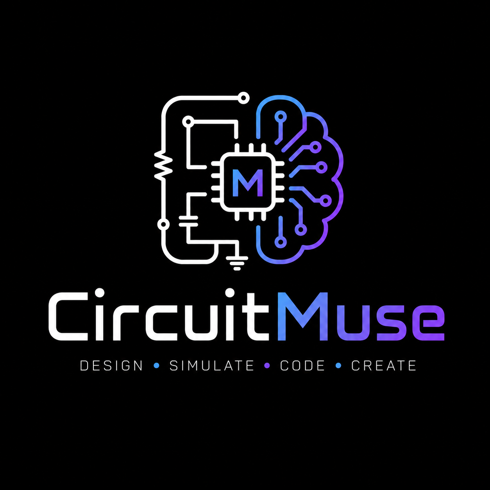

# CircuitMuse

<p align="center">
  
</p>

<p align="center">
  <a href="https://github.com/meshackbahati/circuit-muse/releases"></a>
  <a href="https://github.com/meshackbahati/circuit-muse/blob/main/LICENSE"></a>
  <a href="https://github.com/meshackbahati/circuit-muse/actions"></a>
</p>

CircuitMuse is a desktop application for building microcontroller circuits. The workspace holds a canvas with electronic parts, a code editor with one file group per board, a compiler backed by a local Python engine, and simulators for several board families. An assistant can inspect and change the canvas, write firmware, compile, run, read serial output, repair faults, and flash a compiled image to a physical board. Simulation and project data stay on the machine.

Release packages bundle the desktop shell, the Python engine, and Arduino CLI. Board cores are fetched on first compile, and QEMU runtimes are downloaded when a QEMU board is used.

## What is in a session

- A canvas with boards, components, wires with waypoints, undo and redo, and pin overlays.
- A code editor with independent file groups. Each board owns its source files.
- Compile, Compile All, Run, Run All, Stop, and Reset controls with an output console.
- Electrical verification that reports shorts, LED overcurrent, resistor overpower, and dark indicators.
- A serial monitor with baud detection, input with several line endings, and multiple UART channels on ESP32.
- An oscilloscope that monitors any board and pin, measures frequency and duty, exposes trigger modes and capture, and renders at a bounded redraw rate.
- Sound: buzzers play while the simulation runs on any board. `tone()` plays at its real pitch (measured from the pin in simulated time), a pin held HIGH beeps like an active buzzer, `analogWrite` plays a PWM tone, and LOW is silent. A Sound button in the canvas header mutes it.
- Instruments for voltage and current, plus interactive parts such as pushbuttons, switches, potentiometers, keypads, encoders, and I2C displays that respond to pointer input while the simulation runs.
- A hardware flash dialog that enumerates USB ports, shows readable board names, supports custom port labels, and streams upload progress. ESP32 boards are written with esptool (merged image at 0x0); AVR, RP2040 and other boards use `arduino-cli upload`.
- A schematic view (Schematic button next to Code / Both / Circuit) drawn automatically from the wiring, with reference designators, values, wires between connected pins (or net labels, with the Wires / Labels toggle) and power symbols, and export to KiCad: a `.kicad_sch` schematic, a `.net` netlist and a `.kicad_pro` project. All 305 gallery examples open in KiCad 10 with no ERC errors. Boards and modules get a generated symbol with the pins in use; resistors, capacitors, LEDs, diodes, switches, potentiometers, transistors and power symbols use the standard KiCad libraries.
- A guided tour on first launch, a short "What's new" tour after updates, and Menu → Take the tour to replay it.
- Projects in IndexedDB with autosave, explicit save, history, import, and export.
- A docked assistant panel that can be resized, minimized, or closed, with searchable history, pasted or dropped attachments, image input for vision models, and follow-up messages while it works.

## Supported boards

| Board | CPU | Simulator |
|-------|-----|-----------|
| Arduino Uno, Nano, Mega 2560 | ATmega328P, ATmega2560 | avr8js |
| ATtiny85 | ATtiny85 | avr8js |
| Raspberry Pi Pico and Pico W | RP2040 | rp2040js |
| ESP32 DevKit, CAM, Lolin32 | Xtensa LX6 | QEMU |
| ESP32-S3 and XIAO ESP32-S3 | Xtensa LX7 | QEMU |
| ESP32-C3 and SuperMini | RISC-V RV32IMC | QEMU |
| STM32 Blue Pill and Nucleo | ARM Cortex-M3 | QEMU |
| Raspberry Pi 3B, 4B, 5 | ARM Cortex-A | QEMU |

Release packages are produced for Windows x64, macOS Apple Silicon, and Linux x64. Linux formats are `.deb`, `.rpm`, `.pkg.tar.zst`, and `.AppImage`.

## Install

Download a package from [GitHub Releases](https://github.com/meshackbahati/circuit-muse/releases).

| Platform | Format | Install |
|----------|--------|---------|
| Windows | `.msi` or `.exe` | Run the installer |
| macOS | `.dmg` | Drag to Applications |
| Ubuntu and Debian | `.deb` | `sudo dpkg -i circuit-muse_*.deb` |
| Arch | `.pkg.tar.zst` | `sudo pacman -U circuit-muse-*.pkg.tar.zst` |
| Fedora | `.rpm` | `sudo dnf install ./circuit-muse-*.rpm` |
| Any Linux | `.AppImage` | `chmod +x CircuitMuse_*.AppImage && ./CircuitMuse_*.AppImage` |

The app opens straight into the editor. A setup dialog appears on first launch and reports which tools are present. It detects the host operating system and shows the matching command for manual installs. The Install button downloads the matching build for that system: Arduino CLI from Arduino (when no bundled or system copy works), ESP32 QEMU from Espressif (Xtensa for ESP32/S3 and RISC-V for ESP32-C3), STM32 QEMU Arm from xPack, and the WASI SDK from WebAssembly. Download progress shows inline, failures are reported without leaving the dialog, and several runtimes can download at the same time. Tools install into the app's data folder for the current user, so no administrator rights are needed; Arduino board cores go to the standard `~/.arduino15` folder shared with Arduino IDE. The first compile for a board family installs its core (about 800 MB for ESP32) and shows progress in the output console.

A guided tour starts after first-run setup and can be replayed from the menu. It walks through the views, files, code editor, board picker, parts, canvas, compile, run, serial monitor, oscilloscope, schematic view, sound, flashing, assistant, and menu. Steps whose target is not visible are skipped, and the tour supports keyboard and screen-reader navigation. After an update, people who already took the tour see a short "What's new" with only the new steps.

Closing the window stops the engine and its QEMU or worker processes. The engine also watches the desktop process and exits if the app crashes. Opening the app a second time focuses the window that is already open.

The AppImage needs WebKit2GTK 4.1 and GTK 3 on the host. Software rendering is selected automatically when no GPU render device is found. To force it:

```bash
CIRCUIT_MUSE_SOFTWARE_RENDERING=1 ./CircuitMuse_*.AppImage
```

## Multi-board circuits

A circuit can hold several boards of different families. The canvas header selects the active board, which switches the file explorer to that board's group. Compile acts on the active board; Compile All builds one image per board from its own files. Run All starts every compiled board, and Stop cuts power to all of them. The toolbar Stop calls `stopAllBoards`, so a stale per-board flag cannot leave a board running.

The oscilloscope is board-aware. A channel is a `(board id, pin)` pair, so pin 13 on two boards is tracked separately. The first channel is chosen from the pins the sketch actually drives, and the timebase is set from the sketch delays, which avoids a permanent "waiting for signal" display. The panel provides frequency and duty readouts, rising and falling triggers, single-shot capture, an expanded view, quick channel addition, and a time/div selector.

## The assistant

Open the assistant panel from the toolbar and use the gear icon for provider settings. Each provider has its own base URL and API key fields.

The model list comes from `listModels()` on the configured provider. Manual entry covers endpoints without discovery, and no model catalogue is bundled.

| Provider | Setup |
|----------|-------|
| Ollama | Install Ollama and pull a model. No API key is needed. |
| OpenAI | Add a key from platform.openai.com. |
| Anthropic | Add a key from console.anthropic.com. |
| Google Gemini | Add a key from aistudio.google.com. Gemini 3 requires thought signatures, which the bundled GenAI SDK handles. |
| OpenRouter | Add a key from openrouter.ai. |
| Moonshot | Add a key from the Moonshot console. |
| NVIDIA NIM | Add an NVIDIA API key. The base URL defaults to `https://integrate.api.nvidia.com`. |
| Custom | Any OpenAI-compatible endpoint. |

NVIDIA NIM requests are relayed through the local engine at `/api/ai/nvidia` because NVIDIA sends no CORS headers to the desktop WebView. The relay accepts only `https://integrate.api.nvidia.com/v1/` destinations. Anthropic requests carry the `anthropic-dangerous-direct-browser-access` header. Ollama is local, and its origin policy must include the desktop origin if it has been restricted.

### How the assistant builds a circuit

The assistant works in stages: inspect, build and wire, write code, verify electrically, compile, run, observe, debug, and report. The tool layer enforces the ordering because prompt order alone is not sufficient.

- `get_circuit_state` returns boards, components, wires, and wiring status. `list_available_boards`, `list_available_components`, and `get_pin_names` supply valid identifiers.
- `build_circuit` adds many parts and wires in one call using short refs. `add_component` and `wire_components` handle smaller edits.
- `check_wiring` audits every part. A part passes only when its required pins are connected, its wire endpoints resolve, and the board has a ground connection. The audit reports missing pins, orphan wires, and the next actions.
- `compile_code`, `compile_all_code`, and `run_simulation` refuse to proceed while the audit reports blocking issues. This prevents firmware from being written before the circuit is wired.
- `compile_code` and `compile_all_code` accept `run_after` and `observe_ms`, which combine compile, start, and serial capture in one call. `get_simulation_output` accepts `wait_ms`.
- `verify_circuit` runs before the run to catch shorts and overcurrent.
- A completion gate in the chat service inspects the live stores before accepting a final answer. It sends the assistant back to wiring, compiling, running, or reading serial output when a stage is missing, and it refuses stale firmware after a source change.
- The same inspection tool (compile, check, verify, read output) called three times without any change to the code, wiring or libraries in between stops the turn, which prevents a compile and verify loop. A change in between starts a new count, so compile, fix, compile works.
- When the simulator cannot exercise part of a circuit (for example inputs into an ESP32 running on the stock QEMU), `run_simulation` and `get_simulation_output` report `simulator_limitations` and the assistant tells the user instead of trying to work around it.
- `get_schematic` returns the circuit as a schematic (reference designators, nets, unconnected pins, nets with a single connection) for design review, and `export_kicad` saves the KiCad project, schematic or netlist.
- Stop aborts the provider stream and any running tool, and clears the streaming state on the same click. Synthetic tool results keep the transcript valid after an abort.

The ordering, hard gates, abort path, and provider handling are described in [docs/agent-workflow.md](docs/agent-workflow.md).

The full tool set is `get_circuit_state`, `list_available_boards`, `list_available_components`, `get_pin_names`, `add_board`, `remove_board`, `add_component`, `build_circuit`, `remove_component`, `set_component_property`, `wire_components`, `remove_wire`, `check_wiring`, `verify_circuit`, `update_code`, `read_code`, `compile_code`, `compile_all_code`, `get_compile_output`, `get_schematic`, `export_kicad`, `run_simulation`, `stop_simulation`, `reset_simulation`, `get_simulation_output`, `check_environment`, `install_firmware`, `install_library`, `search_libraries`, `get_installed_libraries`, `set_board_language`, `list_uploaded_files`, `read_uploaded_file`, and `delegate_to_subagent`.

Sub-agent roles are `planner`, `circuit_designer`, `firmware_engineer`, `debugger`, and `verifier`. The assistant continues after tool results, retries provider 503 and busy responses with backoff, compacts long histories into a factual summary, and balances Gemini function call and response parts. Tool calls use native function parts, so Gemini continues executing tools instead of describing them in prose.

Use Attach file in the assistant panel to add text files, images, PDFs, or DOCX documents. Images go to the model with your next message as real image input (Anthropic, OpenAI-compatible, Gemini and Ollama vision models), so a photo or sketch of a circuit can be described and rebuilt; other files are read through `list_uploaded_files` and `read_uploaded_file`. You can keep typing while the assistant works: a follow-up is shown at once and the assistant reads it at its next step. The panel can be widened by dragging its left edge, and the message list only follows new output while you are at the bottom. Chat history is saved with the project.

## Projects

Projects are saved locally in IndexedDB. Autosave runs after canvas, code, or chat changes. Use the Projects button in the toolbar for the project list. `Ctrl+S` (`Cmd+S` on macOS) opens the save dialog with the current name. `Ctrl+Shift+S` opens it with a new project id. Each saved entry shows its board count, component count, chat message count, and last change date.

Import accepts `.vlx`, `.zip`, `.json`, and `.fzz` files. Export writes `.vlx`, `.zip`, `.json`, `.html`, and KiCad (`.kicad_sch`, `.net`, `.kicad_pro`) files. The native `.vlx` format keeps boards, file groups, components, wires with waypoints, board options, libraries, baud rate, and chat history. The `.zip` is a Wokwi project (`diagram.json`, sketch, `libraries.txt`) that also carries the full `.vlx`, so a CircuitMuse round trip loses nothing; plain Wokwi zips import from `diagram.json`. Fritzing `.fzz` import reads parts, positions, rotation, resistor and LED values, wires with bends, and the sketch; parts or pins it cannot map are listed as warnings. A file that fails to import shows an error and leaves the open project unchanged; a successful import opens as a new project.

## Components and simulation

The catalogue has more than 150 parts, including resistors, capacitors, inductors, transistors, LEDs, NeoPixels, servos, relays, pushbuttons, sensors, displays, logic gates, and communication chips. Wires snap to named pins and support waypoints so they can route around parts.

Analog simulation uses ngspice compiled to WebAssembly. Digital and mixed circuits run with the board simulator and shared pin state. Digital inputs follow SPICE-solved net voltages, so buttons, direct 5 V wires, and dividers reach `digitalRead()`. Parts wired to a non-active board drive that board's pin registers. Simulation frames are time-sliced and serial buffers, transcripts, and sample buffers are bounded. Heavy panels (assistant, oscilloscope, schematic, examples, dialogs) load only when opened, so the app stays usable on laptops with 2 GB of RAM.

## Hardware flashing

A compiled board can be flashed to a physical USB board. The lightning button in the canvas header and the board context menu both open the flash dialog. The dialog enumerates serial ports through the Tauri `list_serial_ports` command, which returns the vendor id, product id, manufacturer, product, and serial number. Ports are shown with readable names such as `Arduino Uno (/dev/ttyACM0)` or `CH340 USB serial (COM3)`, and a `Name this port` control stores a custom label locally.

The frontend posts the compiled program to `/api/flash/upload` on the local engine with the port, FQBN, and program format. The engine writes a temporary file with the extension the uploader expects. ESP32 boards are written with the bundled esptool (`write-flash 0x0` for the merged image the compiler produces); other boards use `arduino-cli upload -p PORT -i FILE --fqbn FQBN -v`, which selects avrdude for AVR and picotool for RP2040. Upload output streams back as server-sent events and drives the progress bar. One flash runs per port at a time. The web build cannot enumerate local serial ports, so flash controls are hidden outside the desktop shell.

On Linux, ports appear as `/dev/ttyACM*` or `/dev/ttyUSB*` and the user must belong to the serial group: `dialout` on Debian, Ubuntu and Fedora, `uucp` on Arch. On macOS, ports appear as `/dev/cu.usbmodem*` or `/dev/cu.usbserial*` and adapter chips need a vendor driver. On Windows, ports appear as `COM*` and a vendor driver is required. See [docs/hardware-flashing.md](docs/hardware-flashing.md) for details and limitations.

## Build from source

Prerequisites are Node.js 20 or newer, Python 3.12 or 3.13 (3.14 is not supported by the pinned engine dependencies yet), Rust stable, and the WebKit2GTK development packages for the target platform.

On Ubuntu or Debian:

```bash
sudo apt install -y \
  libwebkit2gtk-4.1-dev libappindicator3-dev librsvg2-dev \
  patchelf libssl-dev libgtk-3-dev libsoup-3.0-dev \
  libjavascriptcoregtk-4.1-dev libudev-dev
```

On Arch:

```bash
sudo pacman -S webkit2gtk-4.1 appmenu-gtk-module libappindicator-gtk3 \
  librsvg patchelf openssl gtk3 libsoup3
```

On Fedora:

```bash
sudo dnf install -y gcc webkit2gtk4.1-devel gtk3-devel libsoup3-devel \
  patchelf openssl-devel
```

Then build:

```bash
git clone https://github.com/meshackbahati/circuit-muse.git
cd circuit-muse

cd app && npm install && cd ..
cd engine && python -m venv venv && source venv/bin/activate
pip install -r requirements.txt && cd ..

bash scripts/download-deps.sh
bash scripts/build-engine.sh

cargo install tauri-cli --version "^2"
cd src-tauri && cargo tauri build
```

Packages appear under `src-tauri/target/release/bundle/`. For development, run `cargo tauri dev` from `src-tauri`.

`src-tauri/binaries/` is ignored by git. `download-deps.sh` and `build-engine.sh` (and the release workflow) put the real sidecars there; for development builds without them, `build.rs` creates empty placeholders and the app falls back to a system arduino-cli or the Python engine in `engine/`. The AppImage step may fail locally when `linuxdeploy` cannot run; the CI release jobs produce the published AppImage.

## Project layout

```text
circuit-muse/
  app/          React, Vite, TypeScript application
  engine/       Python FastAPI compile, AI relay, and flash engine
  src-tauri/    Rust Tauri desktop shell and serial port command
  scripts/      Build helpers
  docs/         Hardware flashing, runtime setup, UI, and agent workflow notes
```

## Troubleshooting

White screen on Linux: force software rendering with the environment variable shown in the install section.

Arduino CLI missing: open Setup from the menu and click Install next to Arduino CLI (no admin rights needed), or run `bash scripts/download-deps.sh` in a source checkout.

Engine not starting: check that Python 3.12 or 3.13 is available, then run `pip install -r requirements.txt` inside `engine/` and restart the app.

Engine port: the engine takes the first free port from 8001 to 8100, or any free port the system offers if all of those are taken, and the app tells the window which one. Nothing needs configuring when another program already uses 8001. If the engine exits while the app is open, the app restarts it and the status bar says so; after repeated failures it shows the reason.

"Could not reach the CircuitMuse engine": the engine is starting or restarting. Compiles wait up to 20 seconds for it. Opening the app a second time focuses the existing window instead of starting another engine.

ESP32 in the open-source build: without the optional `libqemu-xtensa`, ESP32 boards run on Espressif's QEMU. Serial output, timing and pin outputs (LEDs, buzzers) work; Arduino's `loop()` is compiled to run on core 0 for simulation because the second core's timer does not tick in that QEMU build. Signals into the ESP32 (buttons, HC-SR04 echo, DHT data) always read LOW, and I2C/SPI devices such as OLED displays do not answer, so `pulseIn()` returns 0 and the ESP32 logs `i2c_master_transmit failed`. These parts need `libqemu-xtensa` or real hardware; the assistant is told about this limit. AVR and RP2040 boards simulate inputs and I2C devices in the app.

QEMU boards not running: ESP32, STM32, and Raspberry Pi targets need their QEMU runtime. Install it from the board prompt or the setup dialog. The STM32 button installs the xPack QEMU Arm runtime, which supplies `qemu-system-arm` for the host platform. STM32 board emulation inside the app still requires the `libqemu-arm` shared library when that path is selected. See [docs/runtime-setup.md](docs/runtime-setup.md) for the per-platform details.

No serial ports in the flash dialog: attach a board by USB. On Linux add the user to `dialout` (`uucp` on Arch) and log out and back in. On macOS and Windows install the adapter driver.

Assistant returns HTTP 400: the app keeps every tool result paired with its tool call (including after history compaction) and retries once with a shorter transcript. If a provider still rejects a request, start a new chat. With Gemini, confirm that the configured model supports function calling; if no model is selected, the newest stable chat model from the provider's list is used.

## License

MIT

## Author

[Meshack Bahati Ouma](https://github.com/meshackbahati)

## Credits

Based on [Velxio](https://github.com/davidmonterocrespo24/velxio) by David Montero Crespo. Built on [avr8js](https://github.com/wokwi/avr8js), [rp2040js](https://github.com/wokwi/rp2040js), [wokwi-elements](https://github.com/wokwi/wokwi-elements), [ngspice-wasm](https://github.com/wokwi/ngspice-wasm), [lcgamboa/qemu](https://github.com/lcgamboa/qemu), [Espressif QEMU](https://github.com/espressif/qemu), [Tauri](https://tauri.app), and [Monaco Editor](https://microsoft.github.io/monaco-editor/).
